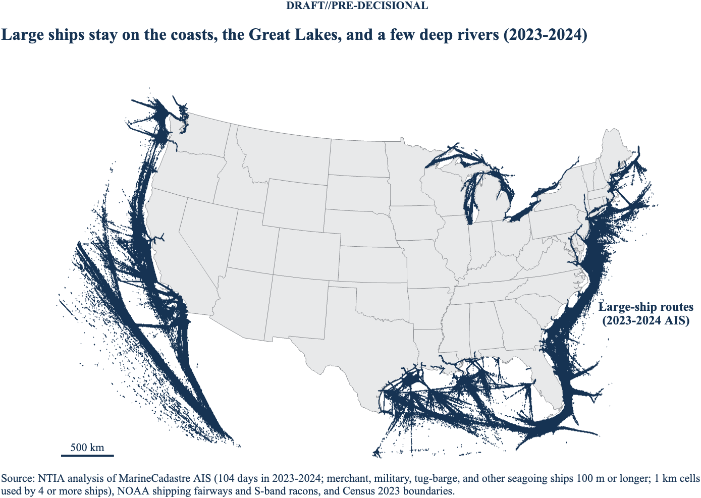
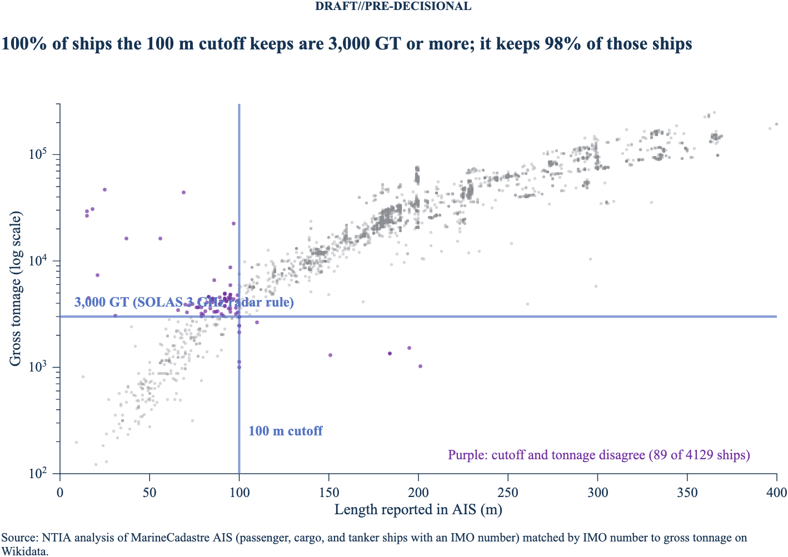

# matlab_shipping_gis

DRAFT//PRE-DECISIONAL

This repository builds geographic zones around the waters where large ships
operate in the lower 48 states and extends each zone a set distance inland,
for example 50 km. The zones support the 2.7 GHz study: large ships carry
2.9–3.1 GHz (S-band) maritime radionavigation radars, so the zones mark where
those radars can operate near land.

Each run produces, for every distance you set, polygons as MATLAB
`polyshape` objects, `[lat lon]` vertex arrays, shapefiles (EPSG:4326), and
KML files, plus a map.

## Who uses 2900–3100 MHz maritime radionavigation

NTIA's band summary lists three groups of users of maritime
radionavigation in 2900–3100 MHz:

| User | Where | How this repo covers it |
| --- | --- | --- |
| Commercial ships (cargo, tanker, passenger, many foreign-flagged; fishing vessels) | Wherever they sail | AIS ships, below |
| Coast Guard and Navy ships | U.S. waters, homeports, operating areas | AIS military and law enforcement ships, 100 m and up; ships that don't broadcast AIS are missed |
| Fixed sites: Coast Guard Vessel Traffic Service radars, racons (Coast Guard and private, for example oil platforms) | Busy harbors, channels, coasts, offshore platforms | Racons charted as S-band are zone sources; VTS areas are checked against the zones |

## Which ships carry an S-band radar

SOLAS Chapter V, Regulation 19 requires ships of 3,000 gross tonnage (GT) and
upward to carry a 3 GHz radar or a second 9 GHz radar, in addition to the
9 GHz radar required from 300 GT. In practice, large merchant ships carry the
3 GHz (S-band, 2.9–3.1 GHz) radar.

AIS reports don't include gross tonnage or radar band, so the code uses AIS
fields as a proxy:

| Filter | Default | Why |
| --- | --- | --- |
| AIS ship type | 60–69 passenger, 70–79 cargo, 80–89 tanker, 35 military, 55 law enforcement, 33 dredging, 0 and 90–99 other | Merchant ships plus Navy, Coast Guard, seagoing dredges, and other large ships |
| Length overall | 100 m or longer | Proxy for 3,000 GT, checked against registry tonnage (see Validation) |
| IMO number | Present, except military and law enforcement | IMO numbers go to seagoing ships; Navy and Coast Guard ships have none |
| Speed | Any | Radars often stay on at anchor |

The proxy isn't sensitive to the length cutoff. On 2024-01-01, U.S. AIS had
1,810 passenger, cargo, and tanker ships at 60 m or longer, 1,674 at 80 m,
1,577 at 100 m, and 1,362 at 150 m.

U.S. domestic ships that don't make international voyages, such as Great
Lakes freighters, fall under 33 CFR 164 instead of SOLAS. Many of them carry
S-band radars anyway. The code keeps them when they pass the filter.

Left out on purpose:

- **Towing (AIS types 31, 32, 52), except tug-barges.** Towing ships 100 m
  or longer with an IMO number (ocean-going articulated tug-barges) are kept
  through a separate filter, `p.filt_towing`, but only within
  `p.towing_coast_km` (25 km) of the Census coastline. Some river towboats
  also report IMO numbers and the length of the whole tow (on 2024-07-10,
  COOPERATIVE SPIRIT and AEP MARINER on the Mississippi). Without the coastal
  rule, a test run reached 15 of 36 inland river ports; with it, none. The
  2023 AIS files report the tug's own length, so few towing ships pass the
  100 m test in 2023 (15 on 2023-07-12, 761 on 2024-07-10).
- **Fishing and special craft (30, 34, 36, 37, 50–54, 56–59).** At 100 m and
  up these were also mostly inland river reports, which points to coding
  errors.
- **Other and dredging entries without an IMO number.** Allowing them pulled
  river towboats into the zones up the Mississippi to Memphis, St. Louis,
  and Dubuque.

## Method

1. **Large-ship cells.** The code samples one AIS day per week for 2023 and
   2024 (104 days). It reads each daily MarineCadastre file in chunks,
   applies the filter, and bins positions onto a 0.01° grid (about 1 km). A
   cell becomes a ship cell when at least four distinct ships report in it in
   one calendar year; each year is counted on its own, and a cell that passes
   in either year is kept. Within 50 km of a deep-draft USACE Principal Port
   (coastal or Great Lakes, 1 million tons or more of foreign trade), two
   ships in a year are enough, which keeps thin approaches such as Searsport
   and Coos Bay. With two ships everywhere, the 2024 run kept 903 cells of
   tug and barge traffic on the upper Mississippi; with four, it kept none.
2. **Fairways.** The code adds NOAA shipping fairways, traffic separation
   schemes, precautionary areas, and recommended routes as ship cells.
3. **Distance field.** The code computes the great-circle distance from every
   grid cell to the nearest ship cell (spherical Earth, KD-tree search over
   the edge cells of the ship area).
4. **Zone definition.** Choose one of two modes:
   - `ships` (used for every area since the November 2026 review): the zone is
     all U.S. land and water within X km of a route cell. Land of other
     countries (Natural Earth 1:10m) is removed, and the land area is the area
     of the clipped land polygon in an equal-area projection (EPSG:6933).
   - `shore` (the earlier default): water within `shore_link_km` (25 km) of ship
     cells is ship water, and land is measured from the Census coastline that
     faces it, so land in an X km zone can be up to X + 25 km from a route.
5. **Polygons.** The code contours the distance field at each distance with
   sub-cell interpolation, builds a `polyshape`, and clips a land-only copy to
   Census state boundaries.

## Data sources

All sources are public.

| Layer | Source |
| --- | --- |
| AIS positions, 2024+ | `https://noaaocm.blob.core.windows.net/ais/csv2/csv<yyyy>/ais-<yyyy-MM-dd>.csv.zst` |
| AIS positions, 2009–2023 | `https://coast.noaa.gov/htdata/CMSP/AISDataHandler/<yyyy>/AIS_<yyyy_MM_dd>.zip` |
| Fairways and TSS | NOAA ENC Direct, `NavigationChartData/MarineTransportation/FeatureServer/0` |
| Land | Census cartographic boundary states, 1:500,000 (`cb_2023_us_state_500k`) |
| Coastline | Census TIGER/Line national coastline (`tl_2023_us_coastline`) |

AIS covers USCG terrestrial receivers in U.S. waters, including the Great
Lakes and inland waterways, at a 1-minute sample.

## Requirements

- MATLAB R2025b with Mapping Toolbox and Statistics and Machine Learning
  Toolbox. Parallel Computing Toolbox is optional.
- The `zstd` command-line tool for 2024+ AIS files: `brew install zstd`.
- About 2 GB of free disk while a day is processed. Each daily file is about
  200 MB compressed and 750–1,000 MB as CSV. The code deletes each CSV after
  it caches that day's ship cells, which take a few MB.

## Output size

A full run writes about 4.5 MB:

| Setting | Default | Effect |
| --- | --- | --- |
| `p.simplify_deg` | 0.005 | Drops polygon vertices within 0.005° (about 0.5 km, half a grid cell) with `reducem`. Cuts vertices about 6 times; the 50 km land zone moves by under 1% of its area. Use 0 to keep every vertex. |
| `p.kmz` | `true` | Also writes a KMZ (zipped KML, about 5 times smaller) next to each KML. |
| `p.save_grids` | `false` | Leaves the full-size grids out of the `.mat` (1.3 MB instead of 33 MB). `true` saves them in compact types. |
| `p.png_dpi` | 200 | Map resolution. |

## Memory and disk

The code works in pieces so a full year fits on a laptop:

- Each AIS day is read in chunks of `p.ais_read_rows` rows (default
  1,000,000, about 150 MB) with a `tabularTextDatastore`, not loaded whole.
- Each day's result is cached in `p.data_dir` (a few MB) and the day's CSV is
  deleted, so a stopped run resumes where it left off.
- Days are merged one at a time into a running set of cell and ship pairs.
- Distances are computed in blocks of `p.block_rows` grid rows (default 200)
  from 1-D coordinate vectors; intermediate grids are cleared before
  contouring.

## Run

1. Edit the settings at the top of `init_shipping_zone_rev1.m`: distances,
   zone mode, AIS days, and folders. Run it from the repo folder so it uses
   the cached inputs in `data/`.
2. Run `init_shipping_zone_rev1`.

To process days in parallel, start a pool and set `p.parallel_flag=1`. Each
worker needs about 2 GB of disk while it works.

## Results, 2024–2025 (lower 48, `ships` mode)

104 AIS days (the first 52 Wednesdays of 2024 and of 2025; set in `period_rev1.m` and `python/ship_period.py`). Until November 12, 2026, the analysis used 2023–2024; those outputs stay in `outputs/2023_2024/`. 2023 and January–June 2026 are held out as stability checks (`python/ship_year_stability.py`). The grid covers 22–50° N and
66–130° W, which takes in the Florida Straits and waters well off the West
Coast.

| Route cells by source | Cells |
| --- | --- |
| AIS cells, 4 or more large ships in a year (tug-barges near the coast included) | 658,865 |
| Port approaches, 2 or more ships within 50 km of 73 deep-draft ports and 25 km of the coastline | 11,682 |
| NOAA fairways and traffic separation schemes not already AIS cells (U.S. side only) | 13,964 |
| S-band racons not already route cells | 13 |
| Total | 684,524 |

| Distance | U.S. land in zone |
| --- | --- |
| 25 km | 301,168 km² |
| 50 km | 638,688 km² |
| 100 km | 1,261,529 km² |

- Named ports: 24 of 24 reached by a continuous route, including Baltimore
  and Baton Rouge.
- USACE Principal Ports: 70 of 73 deep-draft ports reached; 0 of 36 inland
  river ports. Not on the network: Portland, Oregon, and Illinois
  International Port (the USACE reference points sit 6 and 12 km from the
  ship berths), and Searsport (its route cells don't connect to the open-water
  lanes). Panama City now connects through the charted Gulf fairway. All three
  are inside the 25 km zone.
- Baton Rouge: 263 distinct large ships within 3 km on the sampled days
  (138 in 2024, 139 in 2025).
- Vessel Traffic Service: 9 of 10 VTS areas are inside the 25 km zone;
  VTS Louisville, on the Ohio River, is not.

## Filter attrition

`init_filter_funnel_rev1.m` runs the filter one step at a time on one full
day per year (`outputs/2023_2024/ais_filter_funnel.csv` and
`ais_filter_by_type.csv`). Ship counts:

| Step | 2023-07-12 | 2024-07-10 |
| --- | --- | --- |
| All reports | 22,344 | 22,414 |
| Ship type kept (towing included) | 8,948 | 8,295 |
| and length 100 m or more | 1,844 | 2,754 |
| and IMO number (or military or law enforcement) | 1,805 | 2,184 |
| and inside the analysis grid | 1,671 | 1,980 |

Step 4 matches the day caches exactly (1,080,250 and 1,347,288 reports;
1,805 and 2,184 ships), and the caches were built by a separate program
(`ais_cells_py_rev1.py`). That program also reproduces the MATLAB cache for
2024-01-03 cell for cell (166,382 pairs).

## Figures

The maps below are from the earlier 2023–2024 shore-mode run; the current maps are in `outputs/2024_2025/`:

- [Large-ship routes, no buffer](docs/shipping_zone_2023_2024_routes_map.png)
- [New Orleans to Baton Rouge routes, no buffer](docs/shipping_zone_2023_2024_new_orleans_baton_rouge_routes_map.png)
- [Example frequency-dependent zones](docs/shipping_zone_2023_2024_band_zones_map.png)
- Land within X km of large-ship water: [25 km](docs/shipping_zone_2023_2024_shore_25km_us_map.png), [50 km](docs/shipping_zone_2023_2024_shore_50km_us_map.png), [100 km](docs/shipping_zone_2023_2024_shore_100km_us_map.png)
- Routes with the X km buffer: [25 km](docs/shipping_zone_2023_2024_shore_25km_routes_buffer_map.png), [50 km](docs/shipping_zone_2023_2024_shore_50km_routes_buffer_map.png), [100 km](docs/shipping_zone_2023_2024_shore_100km_routes_buffer_map.png)
- [Lower Mississippi with the 50 km zone](docs/shipping_zone_2023_2024_lower_mississippi_50km_map.png)
- [Length filter: what it keeps and drops (working paper Figure 2)](docs/filter_length_vs_gt_2024.png)
- [Length cutoff check](docs/gt_proxy_check_2024.png)

The 2024-only maps from the earlier run stay in `docs/` under `shipping_zone_2024_*`.

## Frequency-dependent zones

`p.band_zones` assigns a zone distance to each part of 2900–3100 MHz. The
default is an example, not an EMC result:

| Band | Distance |
| --- | --- |
| 2900–3000 MHz | 25 km |
| 3000–3030 MHz | 50 km |
| 3030–3070 MHz | 100 km |
| 3070–3100 MHz | 50 km |

Each band gets its own shapefile, KML, and KMZ
(`shipping_zone_2023_2024_band_<f1>-<f2>MHz_<X>km`), a row in
`shipping_zone_2023_2024_band_zones.csv`, and a panel in the band map.

## Output files

`outputs/2023_2024/` holds:

- `shipping_zone_2023_2024_routes`: the route cells as polygons (one
  feature per 1° tile), shapefile and KMZ. The KML is 42 MB, so only the KMZ
  (the same KML, zipped, 1.7 MB) is in the repo; a run writes both.
  `..._routes_ais_only` holds the AIS cells without fairways and racons.
- `shipping_zone_<period>_ships_<X>km` and `..._land`: the zones for 25,
  50, and 100 km (shapefile, KML, KMZ).
- `shipping_zone_2023_2024_band_*`: the frequency-dependent zones.
- `shipping_zone_2023_2024_sites.csv`: racons, VTS areas, named ports, and
  USACE Principal Ports, with distance to the routes and zone membership.
- Port, principal-port, and VTS checks, Baton Rouge ship counts, the filter
  attrition tables, and the `.mat` result.

The 2024-only outputs from the earlier run stay in `outputs/2024/`.

## Ship-data figures

Ten figures on the large-ship data, each with a MATLAB version and a Python
version that compute the same numbers from the same AIS day caches:

| # | Figure | Takeaway |
| --- | --- | --- |
| 1 | Traffic density (map) | The busiest 7% of route cells carry half of all large-ship traffic |
| 2 | Baltimore and the Key Bridge | Large ships in Baltimore harbor fell 40% during the 2024 closure |
| 3 | Seasons by coast | Great Lakes traffic falls by half in winter; the ocean coasts barely change |
| 4 | Length cutoff sweep | At 100 m the length test is right 99.6% of the time and keeps 98.1% of big ships |
| 5 | Filter funnel | About 1 ship in 11 reporting on AIS passes the large-ship filter |
| 6 | Stability between years (map) | 85% of traffic is in cells that pass the threshold in both years |
| 7 | Tug-barge cells (map) | Tug-barges add 1% more route cells |
| 8 | Mississippi profile | Traffic thins above New Orleans but reaches Baton Rouge, 351 river km up |
| 9 | Sites near routes | Every named port and 97% of deep-draft ports are within 5 km of a route |
| 10 | Offshore distance | Half of Pacific and Gulf route cells lie more than 130 km offshore |

- **MATLAB:** `init_ship_viz_rev1.m` runs `viz_products_rev1.m` (the
  numbers) and `plot_ship_viz_rev1.m` (the figures). Figures:
  `docs/viz_matlab/`; tables: `outputs/2023_2024/viz_matlab/`.
- **Python:** `python/ship_viz_products.py` then
  `python/ship_viz_figures.py`, drawn with the NTIA theme of the vendored
  one-page toolkit (`python/onepager.py`, checked with `python/review.py`
  for overlaps, small text, contrast, and color blindness). Figures (PNG,
  PDF, SVG, alt text): `docs/viz_python/`; tables:
  `outputs/2023_2024/viz/`.
- **Cross-check:** the two versions agree within one cell: 661,136 route
  cells in MATLAB and 661,137 in Python, 6,514 and 6,515 tug-barge cells,
  and the same shares, river distances, and offshore medians. The one-cell
  differences come from how each rasterizes the Census coastline for the
  25 km tug-barge rule.

## Geographic figures and the busiest ports

Nine maps of where large ships operate (Appendix A.9 to A.17 of the working
paper), each in MATLAB and Python: hexagon grid, spike map, port close-ups,
offshore distance bands, near-shore profile by coast, deep-draft port
bubbles, ship types (tanker, cargo, passenger, military and law
enforcement), land distance to the nearest route, and S-band racons and VTS
areas over the hexagons.

- **MATLAB:** `init_ship_geo_rev1.m` runs `geo_products_rev1.m` and
  `plot_ship_geo_rev1.m`.
- **Python:** `python/ship_geo_products.py` then `python/ship_geo_figures.py`.
- **Busiest ports:** `geo_ports.csv` ranks the 73 deep-draft ports by
  distinct large ships within 10 km, with counts by ship type. Galveston
  (2,839), New Orleans (2,413), Plaquemines (2,161), Long Beach (1,894), and
  Los Angeles (1,833) lead. MATLAB and Python give identical counts.
- **Ship-type caches:** `python3 ais_cells_py_rev1.py --types data <days>`
  writes one cache per day for each type group (`vt70-79`, `vt80-89`,
  `vt60-69`, `vt35-55`).

## Rivers and ship channels

How far up each river or ship channel large ships go: the Mississippi
profile, extended to 15 corridors defined in `config/corridors_rev1.csv`
(start, ports along the way, head port). For each corridor the code finds
the least-cost path through the route cells (each step costs its length
times 1 + 100 / ships, so the path keeps to the busy channel), assigns route
cells within 2 km of the path to the corridor, and counts distinct ships per
reach, at the entrance, and at the head port (within 3 km along the path).

| Corridor | Head port | km | Ships at entrance | Ships at head |
| --- | --- | --- | --- | --- |
| Mobile Bay | Mobile | 55 | 459 | 424 |
| Savannah River | Garden City | 39 | 750 | 682 |
| Chesapeake Bay | Baltimore | 291 | 1,384 | 789 |
| Columbia River | Vancouver, WA | 175 | 546 | 280 |
| Houston Ship Channel | Houston | 92 | 2,586 | 481 |
| Delaware River | Trenton | 214 | 803 | 136 |
| Mississippi River | Baton Rouge | 360 | 2,084 | 267 |
| Hudson River | Albany | 248 | 1,347 | 78 |
| James River | Hopewell (routes end 22 km below Richmond) | 122 | 938 | 36 |

The full table (15 corridors, by year) is `outputs/2023_2024/viz/corridor_summary.csv`.

- **MATLAB:** `init_ship_corridors_rev1.m` runs `corridor_products_rev1.m`
  (`graph`, `shortestpath`, `KDTreeSearcher`) and
  `plot_ship_corridors_rev1.m`. Figures: `docs/viz_matlab/corr*.png`.
- **Python:** `python/ship_corridor_products.py` then
  `python/ship_corridor_figures.py`. Figures: `docs/viz_python/corr*`.
- **Cross-check:** head counts, by year, match exactly on all 15 corridors.
  Two entrance counts differ by under 2% (James 933 and 938, Calcasieu 393
  and 401) because the two shortest-path solvers break ties between equal
  paths differently.

## Share of port visits

How large-ship port visits split among the 73 deep-draft ports, in ten
figures (Appendix A.20 of the working paper): treemap, circle packing, ranked
bars with a running total, concentration curve, waffle by port complex,
Marimekko by ship type, sunburst (coast, complex, port), Dorling map, 100%
bars within each coast, and 2023 against 2024. A port visit is one distinct
large ship within 10 km of a port, with each 1 km cell assigned to its
nearest port so the visits add up (38,537 in all). Thirteen ports take half
of all visits; Gulf ports take 48%.

- **Config:** `config/port_short_names_rev1.csv` (display names) and
  `config/port_complexes_rev1.csv` (neighboring ports grouped into complexes).
- **MATLAB:** `init_port_share_rev1.m` runs `port_share_products_rev1.m` and
  `plot_port_share_rev1.m`. Figures: `docs/viz_matlab/share*.png`.
- **Python:** `python/ship_port_share_products.py` then
  `python/ship_port_share_figures.py`. Figures: `docs/viz_python/share*`.
- **Cross-check:** all 73 ports match exactly between MATLAB and Python, for
  both years and all four ship types.

## Hawaii

Hawaii uses the same AIS sample, ship filter, zone method, and band distances as
the lower 48, with one change: the **ship-days** route rule. A cell is a route
cell when the distinct large ships seen in it on each sampled day add up to at
least 6 over the 104 days. Under the lower-48 rule (4 distinct ships in one
year) the inter-island lanes break, because a few dedicated ships serve the
neighbor islands. The cutoff of 6 best reproduces the lower-48 network
(Jaccard index 0.81).

| Result | Value |
| --- | --- |
| Route cells (2024–2025) | 7,310 |
| Ports on the route network | Honolulu, Kalaeloa, Kahului, Nawiliwili (Hilo 5.0 km, Kawaihae 25 km away) |
| Land within 25 / 50 / 100 km | 12,351 km² (70%) / 16,720 km² (95%) / 17,573 km² (all) |

Run (MATLAB): `init_shipping_zone_hawaii_rev1` (writes `output_hawaii/`; the repo
copy is `outputs/2024_2025/hawaii/`). Python: `python3 python/ship_route_rules.py`
compares the rules, and `python3 python/ship_hawaii_figures.py` draws `haw01_routes`
and `haw02_zones`. MATLAB and Python give the same 7,310 cells. Data-validity
checks and the plan for Alaska are in `docs/plans/alaska_hawaii_plan_rev1.md`.

## Alaska

MarineCadastre has filtered Alaska out of its daily files since 2021, so Alaska
uses 2018–2019 (the first 52 Wednesdays of each year), the ship-days rule, and a
grid of 51–72° N, 180–129° W (stopping at 180° keeps polygons and KML whole).

| Result | Value |
| --- | --- |
| Route cells from ship tracks (ship-days ≥ 6) | 26,983 |
| Plus NOAA charted lanes | 23,444 |
| Plus satellite-AIS lanes (Kapsar hexagons, 2018–2019) | 318,134 water cells from 400 hexagons |
| Deep-draft ports reached | Anchorage (0.3 km), Valdez (0.6 km) |
| Land within 25 / 50 / 100 km | 179,047 km² (12%) / 261,953 km² (17%) / 409,521 km² (27%) |

Shore receivers miss the lanes far offshore: in the satellite-based North
Pacific and Arctic dataset (Kapsar and others, 2022), 83% of the busiest
hexagons hold no route cell, and 95% of those are more than 74 km from shore
(`python/check_alaska_kapsar.py`). `python/alaska_satellite_lanes.py` adds the
busy hexagons as ship water (`p.extra_source_csv`): cargo plus tanker operating
days of at least 272 over 2018–2019, the cutoff that best matches the
shore-receiver routes within 74 km of shore (Jaccard index 0.57).

Run: `python3 python/alaska_grid_to_180.py` (caches for the 180° grid),
`python3 python/alaska_satellite_lanes.py`, then
`init_shipping_zone_alaska_rev1` in MATLAB (outputs in `outputs/2018_2019/alaska/`),
`python3 python/ship_alaska_routes.py`, and `python3 python/ship_alaska_figures.py`.

## Puerto Rico and the U.S. Virgin Islands

Same sample (2024–2025), filter, route rule, and zones as the lower 48.

| Result | Value |
| --- | --- |
| Route cells | 43,845 (41,237 ship tracks, 2,608 port approaches) |
| Ports on the route network | San Juan, Guaynabo, Ponce, Yabucoa, Charlotte Amalie, Limetree Bay, Frederiksted (Mayaguez 30 km away) |
| Land within 25 / 50 / 100 km | 9,583 km² (96%) / 9,970 km² / 9,970 km² |

Run: `init_shipping_zone_prusvi_rev1` in MATLAB (outputs in
`outputs/2024_2025/prusvi/`), then `python3 python/ship_prusvi_figures.py`.

## Data in the repo

`data/` holds every input the 2023–2024 run uses, so `init_shipping_zone_rev1`
runs without downloading anything:

| File | Content |
| --- | --- |
| `ais_cells_YYYYMMDD_*_rev1.mat` (208 files) | Large-ship grid cells for each of the 104 sampled AIS days: one file for the main filter (`vt0-99-n44`) and one for tug-barges (`vt31-52-n3`). The raw AIS files are 200–300 MB each and aren't stored. `ais_cells_py_rev1.py` rebuilds them without writing the CSV to disk. |
| `racons/` | NOAA chart racon layers (general, coastal, and approach scales) |
| `fairways_rev1.geojson` | NOAA shipping fairways and traffic separation schemes |
| `cb_2023_us_state_500k/` | Census state boundaries, 1:500,000 |
| `tl_2023_us_coastline/` | Census TIGER/Line coastline |
| `wikidata_imo_gt_len.csv` | Wikidata gross tonnage and length by IMO number (queried 2026-11-10) |
| `usace_principal_ports.csv` | USACE Principal Ports: name, type, tonnage, and location (retrieved 2026-11-10) |
| `ais_vessels_2024_4days.csv` | One row per ship from four 2024 AIS days, for the length cutoff check |

## Vessel Traffic Service areas

In the 2023–2024 run, 9 of the 10 Coast Guard VTS areas in the lower 48 are
inside the 25 km zone. VTS Berwick Bay (Morgan City, Louisiana) is within
1 km of a large-ship cell but not on the connected route network. VTS
Louisville, on the Ohio River, serves towboats and is outside every zone.

## Ports the routes must reach

Each run checks two port lists and warns if large-ship routes don't reach a
port.

**Named deep-draft ports (`p.check_ports`, 24 ports).** Baton Rouge (head of
deep-draft navigation on the Mississippi), New Orleans, Houston, Corpus
Christi, Mobile, Tampa, Miami, Savannah, Charleston, Norfolk, Baltimore,
Philadelphia, Newark (New York/New Jersey), Albany, Boston, Los Angeles/Long
Beach, Oakland, Sacramento, Stockton, Portland (Oregon), Seattle, Tacoma,
Duluth, and Chicago. In 2024 all 24 are reached: each is within 1.7 km of a
large-ship cell, on a connected route network, and inside the 25, 50, and
100 km zones. Results: `outputs/2024/shipping_zone_2024_port_check.csv`.

**Every USACE Principal Port in the grid (`p.principal_ports`, 135 ports).**
The run warns only for the 73 coastal and Great Lakes ports with at least
1 million tons of foreign trade. Port locations are USACE district
reference points, so a port counts as reached within 5 km of a ship cell.
Ship cells within 3 cells (about 3 km) of each other count as connected.
Results: `outputs/2024/shipping_zone_2024_principal_port_check.csv`.

| Group | Ports | Reached | In the 25 km zone |
| --- | --- | --- | --- |
| Coastal and Great Lakes, at least 1 million tons foreign | 73 | 65 | 73 |
| Inland river ports (barge traffic) | 36 | 0 | 0 |

The eight deep-draft ports not counted as reached are all inside the 25 km
zone:

- Port of Portland (Oregon) and Illinois International Port (Chicago): the
  USACE reference point sits 6 km and 13 km from the berths. The named
  Portland and Chicago points above are reached.
- Portland (Maine), Portsmouth (New Hampshire), Searsport (Maine), Coos Bay,
  Grays Harbor, and Panama City: large ships reach the port, but few call
  there, so the offshore approach has stretches where fewer than four
  different ships passed in the 52 sampled days. The approach isn't a
  continuous chain of ship cells, though the zone still covers the port.

Inland river ports (St. Louis, Memphis, Pittsburgh, and others) are served by
towboats and barges, not ships of 3,000 GT, so they are correctly left out.

On the Mississippi, large-ship cells run without a break from Head of Passes
to just above Baton Rouge (30.49°N); 251 different large ships used the
Baton Rouge cells in the 52 sampled days.

## Outputs

For each distance `X` in `p.distances_km`, the output folder holds:

| File | Content |
| --- | --- |
| `<name>_<mode>_<X>km.shp`, `.kml`, `.kmz` | Zone: ship water plus land out to X km |
| `<name>_<mode>_<X>km_land.shp`, `.kml`, `.kmz` | The same zone clipped to U.S. land |
| `<name>_port_check.csv` | Distance from each port in `p.check_ports` to the nearest ship cell |
| `<name>_<region>_<X>km_map.png` | Zoomed map for each entry in `p.region_maps` |
| `<name>_<mode>_rev1.mat` | `result` struct: grid, masks, distance field, and zones |
| `<name>_<mode>_map.png` | Diagnostic map: all zones and the ship cells |
| `<name>_<mode>_<X>km_us_map.png` | U.S. map of the land within X km and the large-ship water |
| `<name>_<mode>_<X>km_routes_buffer_map.png` | U.S. map of the large-ship routes and the X km buffer |
| `<name>_routes_map.png` | U.S. map of the large-ship routes |

In `result.zone(k)`, `.poly` and `.poly_land` are planar `polyshape` objects
(x = longitude, y = latitude). `.latlon` and `.latlon_land` are `[lat lon]`
arrays with NaN between rings, ready for `inpolygon` or
`find_points_inside_contour_two_step_rev2`. 

## Validation

- `test_shipping_zone_rev1.m`: URL patterns, the AIS filter on both column
  styles, distances against the Mapping Toolbox `distance` function, the area
  of a 50 km disk (within 1%), polygon rasterization, parallel equals serial,
  and two sessions writing the same cache.
- `zone_bufferm_rev1.m`: an independent check that buffers the ship cells
  with `bufferm`, piece by piece, and unions the pieces. In the Mid-Atlantic
  test box, the `bufferm` zones and the distance-field zones differ by 1.5% of
  area at 25 km and 0.5% at 50 km.

## Length cutoff check

`init_check_gt_proxy_rev1.m` tests the 100 m cutoff against registry gross
tonnage. It takes every passenger, cargo, and tanker ship with an IMO number
seen on four 2024 AIS days (one per season) and matches the IMO numbers to
gross tonnage on Wikidata (81,000 ships with an IMO number, tonnage, and
length, mostly imported from public registers).

- 4,129 of 5,674 AIS ships matched (73%; 68% between 75 and 100 m, 75–84%
  above 100 m).
- At 100 m, 99.6% of the ships the cutoff keeps are 3,000 GT or more
  (3,801 of 3,818), and the cutoff keeps 98.1% of the ships that are
  3,000 GT or more (3,801 of 3,873).
- The 72 ships it misses are mostly 90–99 m cargo ships and ferries;
  12 of them have a wrong AIS length (the register shows 100 m or more).
  Passenger ships have the lowest recall (86%), because many ferries of
  3,000 GT and up are shorter than 100 m.
- The 17 ships it keeps by mistake are 997–2,996 GT, close to the line.
- AIS lengths agree with register lengths: median difference 0.1 m,
  90th percentile 1 m.
- A 90 m cutoff balances the two errors (99.2% and 99.0%).

The tables are in `outputs/2024/gt_proxy_*.csv`.

## Limits

- The 100 m length cutoff stands in for 3,000 GT; the check above found it
  right for about 98% of ships.
- AIS doesn't report radar band or whether the radar is on.
- The grid is 0.01°, so zone edges carry about ±0.5 km of resolution error.
- Alaska, Hawaii, and the territories are outside the default grid.
