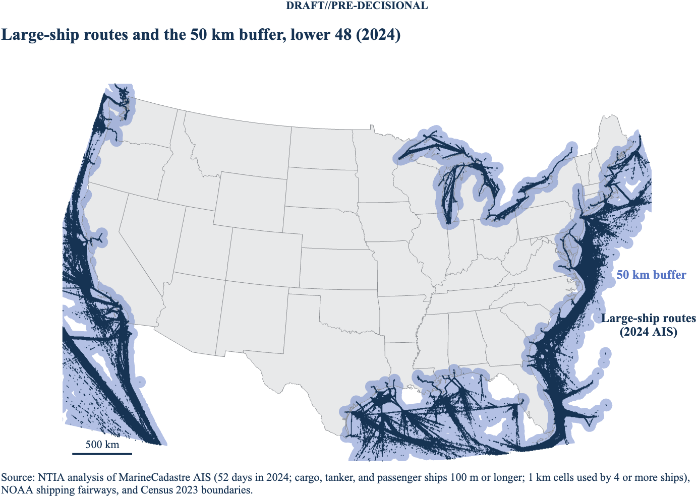
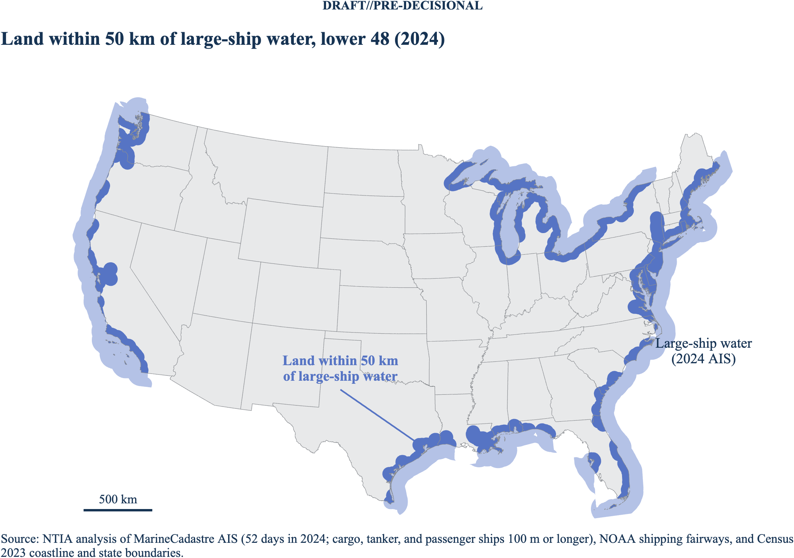

# matlab_shipping_gis

DRAFT//PRE-DECISIONAL

This repository builds geographic zones around the waters where large ships
operate in the lower 48 states and extends each zone a set distance inland,
for example 50 km. The zones support the 2.7 GHz study: large ships carry
2.9–3.1 GHz (S-band) maritime radionavigation radars, so the zones mark where
those radars can operate near land.

Each run produces, for every distance you set, polygons as MATLAB
`polyshape` objects, `[lat lon]` vertex arrays, shapefiles (EPSG:4326), and
KML files, plus a map.

## Which ships carry an S-band radar

SOLAS Chapter V, Regulation 19 requires ships of 3,000 gross tonnage (GT) and
upward to carry a 3 GHz radar or a second 9 GHz radar, in addition to the
9 GHz radar required from 300 GT. In practice, large merchant ships carry the
3 GHz (S-band, 2.9–3.1 GHz) radar.

AIS reports don't include gross tonnage or radar band, so the code uses AIS
fields as a proxy:

| Filter | Default | Why |
| --- | --- | --- |
| AIS ship type | 60–69 passenger, 70–79 cargo, 80–89 tanker | Container ships, bulkers, car carriers, tankers, and cruise ships |
| Length overall | 100 m or longer | Proxy for 3,000 GT, checked against registry tonnage (see Validation) |
| IMO number | Present | IMO numbers go to seagoing SOLAS ships |
| Speed | Any | Radars often stay on at anchor |

The proxy isn't sensitive to the length cutoff. On 2024-01-01, U.S. AIS had
1,810 passenger, cargo, and tanker ships at 60 m or longer, 1,674 at 80 m,
1,577 at 100 m, and 1,362 at 150 m.

U.S. domestic ships that don't make international voyages, such as Great
Lakes freighters, fall under 33 CFR 164 instead of SOLAS. Many of them carry
S-band radars anyway. The code keeps them when they pass the filter.

## Method

1. **Large-ship cells.** The code samples one AIS day per week for a year
   (52 days by default). It reads each daily MarineCadastre file in chunks,
   applies the filter, and bins positions onto a 0.01° grid (about 1 km). A
   cell becomes a ship cell when at least four distinct ships report in it
   over the sampled days. With two, the 2024 run kept 903 cells of tug and
   barge traffic on the upper Mississippi that passed the type and length
   filter; with four, it kept none, while the Columbia, Sacramento, Hudson,
   St. Lawrence, and lower Mississippi ports stay in.
2. **Fairways.** The code adds NOAA shipping fairways, traffic separation
   schemes, precautionary areas, and recommended routes as ship cells.
3. **Distance field.** The code computes the great-circle distance from every
   grid cell to the nearest ship cell (spherical Earth, KD-tree search over
   the edge cells of the ship area).
4. **Zone definition.** Choose one of two modes:
   - `shore` (default): water within `shore_link_km` (25 km) of ship cells is
     ship water. Land is measured from the Census coastline that faces ship
     water. The zone runs from the ship water to X km inland. River ports that
     the coastline layer omits, such as Baton Rouge and Portland, Oregon, are
     covered because the distance to the ships themselves also counts.
   - `ships`: the zone is everything within X km of a ship cell.
5. **Polygons.** The code contours the distance field at each distance with
   sub-cell interpolation, builds a `polyshape`, and clips a land-only copy to
   Census state boundaries.

## Data sources

All sources are public.

| Layer | Source |
| --- | --- |
| AIS positions, 2024+ | `https://noaaocm.blob.core.windows.net/ais/csv2/csv<yyyy>/ais-<yyyy-MM-dd>.csv.zst` |
| AIS positions, 2009–2023 | `https://coast.noaa.gov/htdata/CMSP/AISDataHandler/<yyyy>/AIS_<yyyy_MM_dd>.zip` |
| Fairways and TSS | NOAA ENC Direct, `NavigationChartData/MarineTransportation/FeatureServer/0` |
| Land | Census cartographic boundary states, 1:500,000 (`cb_2023_us_state_500k`) |
| Coastline | Census TIGER/Line national coastline (`tl_2023_us_coastline`) |

AIS covers USCG terrestrial receivers in U.S. waters, including the Great
Lakes and inland waterways, at a 1-minute sample.

## Requirements

- MATLAB R2025b with Mapping Toolbox and Statistics and Machine Learning
  Toolbox. Parallel Computing Toolbox is optional.
- The `zstd` command-line tool for 2024+ AIS files: `brew install zstd`.
- About 2 GB of free disk while a day is processed. Each daily file is about
  200 MB compressed and 750–1,000 MB as CSV. The code deletes each CSV after
  it caches that day's ship cells, which take a few MB.

## Output size

A full run writes about 4.5 MB:

| Setting | Default | Effect |
| --- | --- | --- |
| `p.simplify_deg` | 0.005 | Drops polygon vertices within 0.005° (about 0.5 km, half a grid cell) with `reducem`. Cuts vertices about 6 times; the 50 km land zone moves by under 1% of its area. Use 0 to keep every vertex. |
| `p.kmz` | `true` | Also writes a KMZ (zipped KML, about 5 times smaller) next to each KML. |
| `p.save_grids` | `false` | Leaves the full-size grids out of the `.mat` (1.3 MB instead of 33 MB). `true` saves them in compact types. |
| `p.png_dpi` | 200 | Map resolution. |

## Memory and disk

The code works in pieces so a full year fits on a laptop:

- Each AIS day is read in chunks of `p.ais_read_rows` rows (default
  1,000,000, about 150 MB) with a `tabularTextDatastore`, not loaded whole.
- Each day's result is cached in `p.data_dir` (a few MB) and the day's CSV is
  deleted, so a stopped run resumes where it left off.
- Days are merged one at a time into a running set of cell and ship pairs.
- Distances are computed in blocks of `p.block_rows` grid rows (default 200)
  from 1-D coordinate vectors; intermediate grids are cleared before
  contouring.

## Run

1. Edit the settings at the top of `init_shipping_zone_rev1.m`: distances,
   zone mode, AIS days, and folders. Run it from the repo folder so it uses
   the cached inputs in `data/`.
2. Run `init_shipping_zone_rev1`.

To process days in parallel, start a pool and set `p.parallel_flag=1`. Each
worker needs about 2 GB of disk while it works.

## 2024 results (lower 48, `shore` mode)

52 AIS days (one a week in 2024), 1,580–2,090 large ships a day, 468,246 ship
cells plus 1,499 fairway-only cells, 20,476 coastline cells that face ship
water.

Spot checks at 50 km: Chicago, Duluth, Houston, Baton Rouge, Portland
(Oregon), Sacramento, Seattle, Albany, and Washington, D.C. are in the zone;
Denver, Memphis, St. Louis, Nashville, Atlanta, Pittsburgh, and Jackson
(Mississippi) are not.

## Figures

The 2024 maps are in `docs/`:

| Map | 25 km | 50 km | 100 km |
| --- | --- | --- | --- |
| Land within X km of large-ship water | [25 km](docs/shipping_zone_2024_shore_25km_us_map.png) | [50 km](docs/shipping_zone_2024_shore_50km_us_map.png) | [100 km](docs/shipping_zone_2024_shore_100km_us_map.png) |
| Large-ship routes with the X km buffer | [25 km](docs/shipping_zone_2024_shore_25km_routes_buffer_map.png) | [50 km](docs/shipping_zone_2024_shore_50km_routes_buffer_map.png) | [100 km](docs/shipping_zone_2024_shore_100km_routes_buffer_map.png) |

Other maps:

- [Large-ship routes alone](docs/shipping_zone_2024_routes_map.png)
- [Lower Mississippi, Gulf to Baton Rouge, with the 50 km zone](docs/shipping_zone_2024_lower_mississippi_50km_map.png)
- [Diagnostic map: all three zones and the ship cells](docs/shipping_zone_2024_shore_map.png)
- [Length cutoff check](docs/gt_proxy_check_2024.png)

## 2024 zone files

`outputs/2024/` holds the 2024 zones for 25, 50, and 100 km as shapefiles
(EPSG:4326), KML files, and KMZ files for Google Earth:

- `shipping_zone_2024_shore_<X>km`: ship water plus land out to X km.
- `shipping_zone_2024_shore_<X>km_land`: the same zone clipped to U.S. land.

It also holds `shipping_zone_2024_shore_rev1.mat` (the zones plus the
full-size grids in compact types), `shipping_zone_2024_port_check.csv`, and
the length cutoff tables (`gt_proxy_*.csv`).

## Data in the repo

`data/` holds every input the 2024 run used, so `init_shipping_zone_rev1`
runs without downloading anything:

| File | Content |
| --- | --- |
| `ais_cells_2024MMDD_*_rev1.mat` (52 files) | Large-ship grid cells for each sampled AIS day (the raw AIS files are 200 MB each and aren't stored) |
| `fairways_rev1.geojson` | NOAA shipping fairways and traffic separation schemes |
| `cb_2023_us_state_500k/` | Census state boundaries, 1:500,000 |
| `tl_2023_us_coastline/` | Census TIGER/Line coastline |
| `wikidata_imo_gt_len.csv` | Wikidata gross tonnage and length by IMO number (queried 2026-11-10) |
| `usace_principal_ports.csv` | USACE Principal Ports: name, type, tonnage, and location (retrieved 2026-11-10) |
| `ais_vessels_2024_4days.csv` | One row per ship from four 2024 AIS days, for the length cutoff check |

## Ports the routes must reach

Each run checks two port lists and warns if large-ship routes don't reach a
port.

**Named deep-draft ports (`p.check_ports`, 24 ports).** Baton Rouge (head of
deep-draft navigation on the Mississippi), New Orleans, Houston, Corpus
Christi, Mobile, Tampa, Miami, Savannah, Charleston, Norfolk, Baltimore,
Philadelphia, Newark (New York/New Jersey), Albany, Boston, Los Angeles/Long
Beach, Oakland, Sacramento, Stockton, Portland (Oregon), Seattle, Tacoma,
Duluth, and Chicago. In 2024 all 24 are reached: each is within 1.7 km of a
large-ship cell, on a connected route network, and inside the 25, 50, and
100 km zones. Results: `outputs/2024/shipping_zone_2024_port_check.csv`.

**Every USACE Principal Port in the grid (`p.principal_ports`, 135 ports).**
The run warns only for the 73 coastal and Great Lakes ports with at least
1 million tons of foreign trade. Port locations are USACE district
reference points, so a port counts as reached within 5 km of a ship cell.
Ship cells within 3 cells (about 3 km) of each other count as connected.
Results: `outputs/2024/shipping_zone_2024_principal_port_check.csv`.

| Group | Ports | Reached | In the 25 km zone |
| --- | --- | --- | --- |
| Coastal and Great Lakes, at least 1 million tons foreign | 73 | 65 | 73 |
| Inland river ports (barge traffic) | 36 | 0 | 0 |

The eight deep-draft ports not counted as reached are all inside the 25 km
zone:

- Port of Portland (Oregon) and Illinois International Port (Chicago): the
  USACE reference point sits 6 km and 13 km from the berths. The named
  Portland and Chicago points above are reached.
- Portland (Maine), Portsmouth (New Hampshire), Searsport (Maine), Coos Bay,
  Grays Harbor, and Panama City: large ships reach the port, but few call
  there, so the offshore approach has stretches where fewer than four
  different ships passed in the 52 sampled days. The approach isn't a
  continuous chain of ship cells, though the zone still covers the port.

Inland river ports (St. Louis, Memphis, Pittsburgh, and others) are served by
towboats and barges, not ships of 3,000 GT, so they are correctly left out.

On the Mississippi, large-ship cells run without a break from Head of Passes
to just above Baton Rouge (30.49°N); 251 different large ships used the
Baton Rouge cells in the 52 sampled days.

## Outputs

For each distance `X` in `p.distances_km`, the output folder holds:

| File | Content |
| --- | --- |
| `<name>_<mode>_<X>km.shp`, `.kml`, `.kmz` | Zone: ship water plus land out to X km |
| `<name>_<mode>_<X>km_land.shp`, `.kml`, `.kmz` | The same zone clipped to U.S. land |
| `<name>_port_check.csv` | Distance from each port in `p.check_ports` to the nearest ship cell |
| `<name>_<region>_<X>km_map.png` | Zoomed map for each entry in `p.region_maps` |
| `<name>_<mode>_rev1.mat` | `result` struct: grid, masks, distance field, and zones |
| `<name>_<mode>_map.png` | Diagnostic map: all zones and the ship cells |
| `<name>_<mode>_<X>km_us_map.png` | U.S. map of the land within X km and the large-ship water |
| `<name>_<mode>_<X>km_routes_buffer_map.png` | U.S. map of the large-ship routes and the X km buffer |
| `<name>_routes_map.png` | U.S. map of the large-ship routes |

In `result.zone(k)`, `.poly` and `.poly_land` are planar `polyshape` objects
(x = longitude, y = latitude). `.latlon` and `.latlon_land` are `[lat lon]`
arrays with NaN between rings, ready for `inpolygon` or
`find_points_inside_contour_two_step_rev2`. 

## Validation

- `test_shipping_zone_rev1.m`: URL patterns, the AIS filter on both column
  styles, distances against the Mapping Toolbox `distance` function, the area
  of a 50 km disk (within 1%), polygon rasterization, parallel equals serial,
  and two sessions writing the same cache.
- `zone_bufferm_rev1.m`: an independent check that buffers the ship cells
  with `bufferm`, piece by piece, and unions the pieces. In the Mid-Atlantic
  test box, the `bufferm` zones and the distance-field zones differ by 1.5% of
  area at 25 km and 0.5% at 50 km.

## Length cutoff check

`init_check_gt_proxy_rev1.m` tests the 100 m cutoff against registry gross
tonnage. It takes every passenger, cargo, and tanker ship with an IMO number
seen on four 2024 AIS days (one per season) and matches the IMO numbers to
gross tonnage on Wikidata (81,000 ships with an IMO number, tonnage, and
length, mostly imported from public registers).

- 4,129 of 5,674 AIS ships matched (73%; 68% between 75 and 100 m, 75–84%
  above 100 m).
- At 100 m, 99.6% of the ships the cutoff keeps are 3,000 GT or more
  (3,801 of 3,818), and the cutoff keeps 98.1% of the ships that are
  3,000 GT or more (3,801 of 3,873).
- The 72 ships it misses are mostly 90–99 m cargo ships and ferries;
  12 of them have a wrong AIS length (the register shows 100 m or more).
  Passenger ships have the lowest recall (86%), because many ferries of
  3,000 GT and up are shorter than 100 m.
- The 17 ships it keeps by mistake are 997–2,996 GT, close to the line.
- AIS lengths agree with register lengths: median difference 0.1 m,
  90th percentile 1 m.
- A 90 m cutoff balances the two errors (99.2% and 99.0%).

The tables are in `outputs/2024/gt_proxy_*.csv`.

## Limits

- The 100 m length cutoff stands in for 3,000 GT; the check above found it
  right for about 98% of ships.
- AIS doesn't report radar band or whether the radar is on.
- The grid is 0.01°, so zone edges carry about ±0.5 km of resolution error.
- Alaska, Hawaii, and the territories are outside the default grid.
